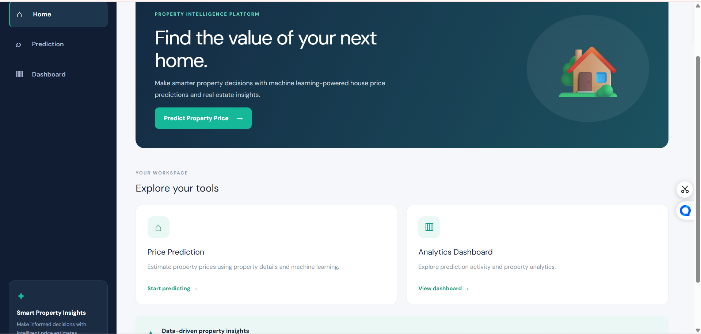
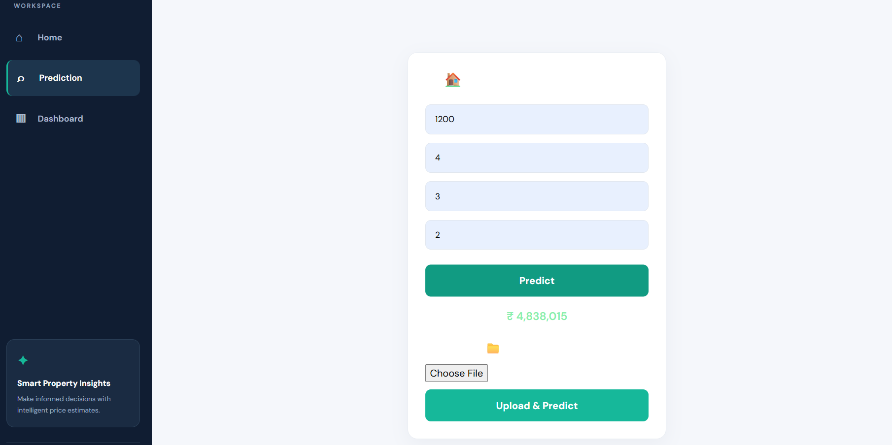
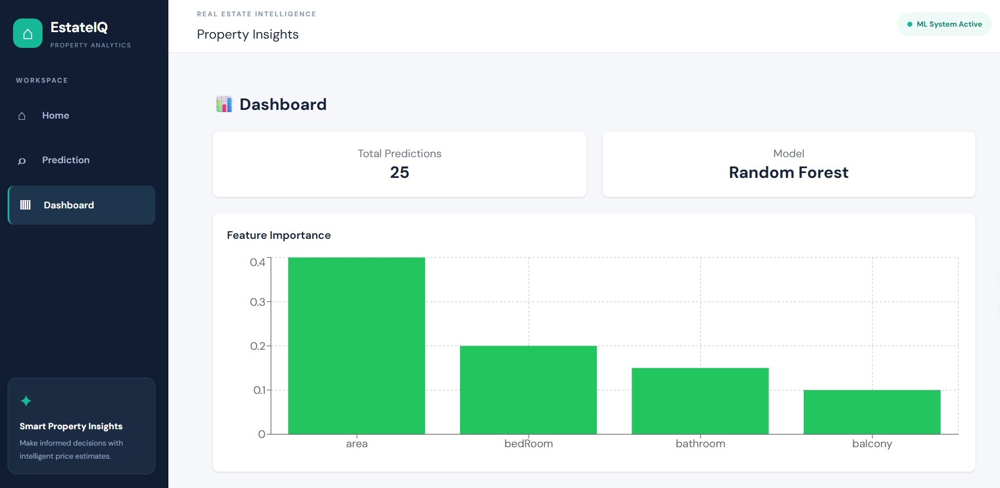

# House Price Prediction ML

A machine learning-based house price prediction application built using Python, FastAPI, React, and Random Forest Regression.

## Project Overview

This project predicts house prices based on property characteristics and provides a web interface for interacting with the prediction system.

## Technologies Used

**Machine Learning & Backend**
- Python
- Pandas and NumPy
- Scikit-learn
- Random Forest Regressor
- FastAPI
- SQLite

**Frontend**
- React
- Vite
- Axios
- React Router
- Recharts
- Tailwind CSS

## Project Structure

```text
HPP/
├── backend/
│   ├── app/
│   │   ├── routes/
│   │   ├── services/
│   │   ├── utils/
│   │   └── main.py
│   ├── models/
│   └── train_model.py
├── frontend/
│   ├── src/
│   ├── public/
│   └── package.json
├── model_outputs/
├── outputs/
├── data_preparation.py
├── model_training.py
├── test_model.py
├── house_data.csv
├── requirements.txt
└── README.md
```

## Machine Learning Model

The backend training script uses Random Forest Regression.

The training script uses:
- Area
- Bedrooms
- Bathrooms
- Parking

The target variable is house price.

The model is saved using Joblib.

## Features

- House price prediction
- FastAPI backend
- React frontend
- Prediction and dashboard API routes
- SQLite prediction storage
- Model evaluation visualizations
- Data preparation and model training scripts

## Installation and Setup

### 1. Clone the repository

```bash
git clone https://github.com/anuanusha3531-ux/House-Price-Prediction-ML.git
cd House-Price-Prediction-ML
```

### 2. Install Python dependencies

```bash
pip install -r requirements.txt
```

### 3. Start the backend

```bash
cd backend
uvicorn app.main:app --reload
```

Backend API:
`http://127.0.0.1:8000`

API documentation:
`http://127.0.0.1:8000/docs`

### 4. Start the frontend

Open another terminal:

```bash
cd frontend
npm install
npm run dev
```

Open the local URL displayed by Vite.

## Model Outputs

The `model_outputs/` and `outputs/` directories contain model evaluation artifacts, feature importance visualizations, and data analysis outputs.

## Author

**Anusha H.M.**

MCA Graduate | Python Developer | Data Analytics & Machine Learning Enthusiast

GitHub: https://github.com/anuanusha3531-ux
## Application Screenshots

### 1. Home Page


### 2. House Price Prediction


### 3. Analytics Dashboard
